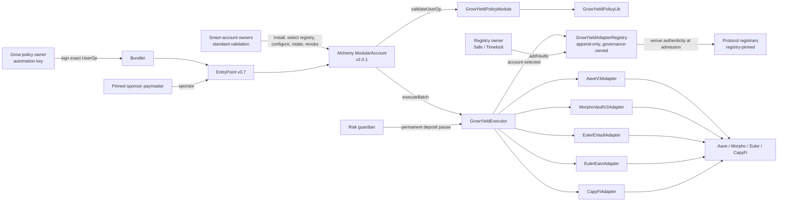
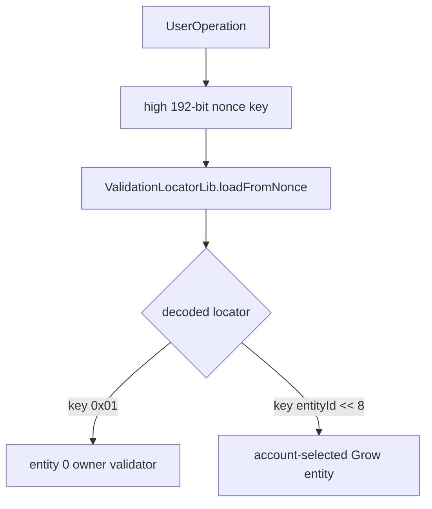
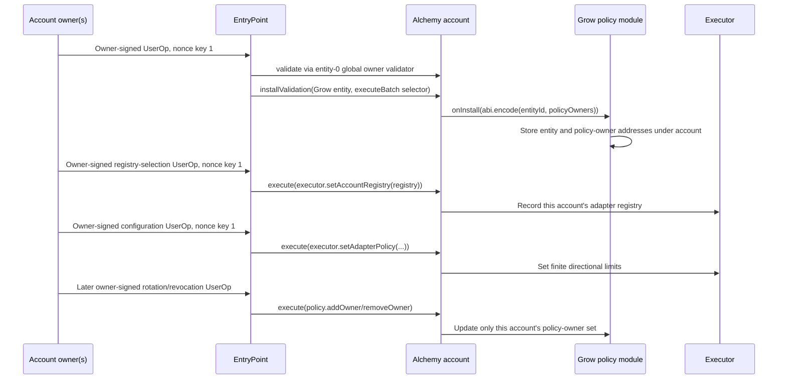

# GrowYield validation architecture

## Scope and pinned account

GrowYield is a selector-associated ERC-6900 UserOperation validator plus a tightly
bounded yield executor. This repository tests the integration against the actual
Alchemy `ModularAccount` source at tag `v2.0.1`, commit
`efab648bd91f79685571af7fa88171e3c142f2f6`, and EntryPoint v0.7.

The production account may use a multi-owner validation module for its normal owner
path. The local compatibility test uses a small SingleSigner harness for that owner
path; owner aggregation is independent of Grow's nonce routing and module payload.
If “MultiOwner Modular Account” means Alchemy's older v1 MSCA factory/plugin product
rather than a multi-owner validator installed on Modular Account v2, its encoder must
be verified separately—the two account generations do not share UserOperation
framing.

## System architecture



The layers are deliberately separate:

| Layer | Enforced property |
|---|---|
| Alchemy account | Selects the installed validation entity and applies selector scope |
| Policy module | Authenticates an account-scoped policy owner and constrains UserOp fields |
| Policy library | Accepts only one canonical approve/execute/revoke batch shape |
| Executor | Resolves the account's registry, pins recipients and amounts, checks output floors, budgets, and pauses |
| Registry | Admits factory-authenticated venues and fixes their directions, token pairs, and runtime code hashes |
| Adapters | Translate the uniform executor API into venue-specific calls and drift checks |

## Contract catalogue

### `GrowYieldPolicyModule`

This is the UserOperation-only validation module. Per smart account it stores:

- The nonzero validation `entityId` chosen during installation.
- Up to eight policy-owner addresses.

The entity is account-configurable because ERC-6900 entity IDs are unique within an
account, not globally reserved. Example entity `1` is suitable only after confirming
that the account has not already allocated it.

For each UserOperation the module requires:

- The account calls the module on its own UserOperation (`msg.sender == userOp.sender`).
- The entity passed by the account equals the entity stored for that account.
- No `initCode`.
- The constructor-pinned paymaster.
- Verification, call, pre-verification, paymaster, priority-fee, and max-fee fields at
  or below immutable ceilings.
- Canonical Grow calldata accepted by `GrowYieldPolicyLib`.
- A 65-byte ECDSA authorization over the exact `userOpHash`.
- A recovered signer present in the account's policy-owner set.

The module returns no ERC-4337 time range and does not read `block.timestamp` during
validation.

Policy-owner management functions are `addOwner` and `removeOwner`. They
key changes by `msg.sender`, so the smart account itself must call them through its
normal owner-authorized path. The Grow policy cannot call either function.

### `GrowYieldPolicyLib`

The library accepts exactly this `executeBatch` shape:

```text
approve(sourceToken[0], executor, uint256.max)
...
approve(sourceToken[n], executor, uint256.max)
executor.execute(Operation[])
approve(sourceToken[0], executor, 0)
...
approve(sourceToken[n], executor, 0)
```

Source tokens are the unique operation source tokens in first-appearance order. The
library rejects noncanonical ABI, native value, self-calls, extra bytes, more than
four operations, zero adapters/tokens, and any operation without an absolute output
floor. The executor independently re-derives each token from the adapter.

### `GrowYieldExecutor`

Every operation is signed as the following static tuple:

```solidity
struct Operation {
    IYieldAdapter adapter;
    OperationKind kind;       // DEPOSIT or REDEEM
    address sourceToken;
    uint256 amount;
    AmountMode amountMode;    // EXACT, FULL_BALANCE, PREVIOUS_OUTPUT
    uint256 minAmountOut;     // absolute signed floor
}
```

Amount modes are explicit:

| Mode | Meaning |
|---|---|
| `EXACT` | Use the nonzero signed `amount` |
| `FULL_BALANCE` | Use the caller's current source-token balance; `amount` must be zero |
| `PREVIOUS_OUTPUT` | Use only the immediately preceding operation's measured output; `amount` must be zero and tokens must match |

`PREVIOUS_OUTPUT` is the safe rebalance mode. It prevents a rebalance from sweeping
unrelated idle underlying already held by the account.

For every operation the executor:

1. Resolves the calling account's selected registry once for the whole batch, then confirms
   registry direction, account policy, code hash, and deposit-pause state.
2. Re-derives source and output tokens and checks the signed source declaration.
3. Resolves the explicit amount mode and consumes the directional epoch budget.
4. Reads the adapter preview.
5. Transfers the exact source amount directly from the account to the adapter.
6. Invokes the adapter, which credits output directly to the account.
7. Rejects new residual balances or fee-on-transfer source behavior (one wei of
   rebasing-token rounding, e.g. aTokens, is tolerated).
8. Measures actual account output.
9. Requires output to meet both the preview-relative floor and signed absolute floor.

The effective floor is:

```text
max(
  ceil(preview * (10_000 - maxLossBps) / 10_000),
  operation.minAmountOut
)
```

The preview-relative check limits unexpected venue slippage. The absolute floor
protects against a manipulated or compromised preview returning a misleading value.

### Account registry selection

The executor holds no global registry and has **no owner**. Each account selects the registry
its own operations are checked against:

```solidity
mapping(address account => IGrowYieldAdapterRegistry) public accountRegistry;

function setAccountRegistry(IGrowYieldAdapterRegistry registry_) external;
```

The selection is keyed by `msg.sender`, so only the smart account can change its own. Because
`GrowYieldPolicyLib` accepts exactly one batch shape and that shape contains nothing but
`approve` / `executor.execute` / `approve`, **no policy-owner signature can ever produce this
call**. Changing the registry therefore requires the account's own owner-authorized validation
path — the same path that installs the module and sets adapter limits. Session keys and the
Grow backend are excluded by construction, with no extra signature scheme to audit.

A selection must be a deployed registry that authorizes this executor and has already admitted
at least one vault. The last condition rejects two silent mistakes at selection time rather
than at the first operation: an adapter address (adapters also report `executor()`), and an
empty registry no operation could use. Registries are append-only, so a registry that
satisfies the condition can never stop satisfying it.

Reselection is permitted and is the venue-expansion path: governance deploys a registry that
supports a new protocol, and each account opts in with one owner-signed call. Reselection
re-gates execution immediately — an adapter absent from the new registry reverts
`AdapterNotAllowed`. Per-adapter limits already set by the account survive, because admission
and limits are independent gates: an operation needs the registry to permit the direction
**and** the account to have a nonzero limit for it, so a new registry can never silently
enable a venue the account has not separately authorized.

The batch resolves the registry once. A reentrant reselection cannot change the rules being
applied to an in-flight batch (and `execute` is `nonReentrant` regardless).

An account that has selected no registry cannot execute or configure anything:
`RegistryNotSet`.

### Adapter policies

Each account owns separate deposit and redeem source-volume limits for every registered
adapter. `setAdapterPolicy` changes limits without clearing already-consumed volume.
Changing the epoch duration requires `resetAdapterPolicy`, which explicitly resets
usage and emits `AdapterPolicyUsageReset`.

`type(uint256).max` is rejected as `UnboundedPolicy`: it would make the quantitative
limit meaningless. Limits must be finite and chosen in the source token's native
units. Zero disables one direction; two zero limits revoke the adapter for that
account while retaining prior usage unless an explicit reset is requested.

### Risk guardian

The executor has one immutable `riskGuardian`. It can permanently pause new deposits
through an adapter, for every account and every registry at once. It cannot unpause, move
funds, change limits, admit an adapter, or block redemptions. This adds incident-response
value without giving the guardian a withdrawal or migration power. Recovery from a false
pause requires a new deployment and owner-approved migration.

Because registries are per-account there is no single set to check membership against, so the
pause target must instead prove it authorizes this executor (`IYieldAdapter.executor()`). A
mistyped address therefore reverts `AdapterNotAllowed` rather than recording a pause that
protects nothing.

### Trust boundary: authenticity vs Grow approval

Adapter constructor and per-operation protocol checks answer only:

> “Is this a genuine canonical deployment of the named protocol (Euler factory
> proxy / Earn vault / CapyFi listed market / Aave reserve / Morpho wrapper)?”

They do **not** answer:

> “Is this vault or market an acceptable Grow yield venue?”

That second decision is made solely by **the registry owner calling `addVaults`**. The
registry is Grow's approval and risk-admission layer: which venues exist, which directions
are enabled, and which runtime code hashes the executor will accept. A factory-authentic
Euler vault that is absent from the registry cannot be used. Conversely, admission without
passing the adapter's own authenticity checks fails closed at construction or execution.

The registry does **not** take the owner's word on authenticity. It re-derives the venue from
`IYieldAdapter.positionToken()` and asks its own constructor-pinned registrar, so admitting a
venue the protocol never created is impossible even for a compromised owner. Risk judgement
is delegated to the owner; provenance is not.

### `GrowYieldAdapterRegistry`

The registry is `Ownable2Step` and **append-only**. `addVaults` is its only writer: an
admitted entry's adapter, protocol, directions, code hash, and venue binding are never
mutated or removed. It records:

- Each adapter in admission order (`adapterCount` / `adapterAt`).
- Deposit and redeem permissions, plus the admitting protocol (`vaultProtocol`).
- Each adapter's admission-time runtime code hash.
- Each venue's position token → underlying binding.

The owner should be a Safe or TimelockController. Once the intended venue set is final the
owner may `renounceOwnership()`, making the registry fully immutable. There is no delisting
path: deposit-side wind-down is the risk guardian's permanent `pauseAdapterDeposits`, and any
account can zero its own directional limits, so no mutation can ever strip `canRedeem` and
trap an account in a position.

There is no lifetime vault ceiling. Nothing on-chain iterates the admitted set — `adapterAt`
and `adapterCount` are O(1) and no loop reads the whole array — so a cap would buy nothing and
would introduce a cliff at which a purely numeric limit, unrelated to protocol support, forces a
registry migration and a re-consent from every account. The venue count is bounded by governance
intent alone.

Proxies remain unsuitable as adapters: a proxy's runtime code hash can stay constant while
its implementation changes.

#### Constructor-pinned registrars

The registry pins one canonical registrar set per supported protocol, immutably:

| Field | Protocol | Used for |
|---|---|---|
| `aavePool`, `aaveDataProvider` | `AAVE` | Reserve lookup and adapter wiring |
| `morphoVaultFactory`, `morphoAdapterFactory`, `morphoEligibility` | `MORPHO` | Wrapper, liquidity-adapter, and child authentication |
| `eulerEVaultFactory` | `EULER_EVK` | EVault proxy authentication |
| `eulerEarnFactory` | `EULER_EARN` | Earn vault authentication |
| `capyFiComptroller` | `CAPYFI` | Market listing |

A zero address marks that protocol **unsupported by this registry**; `addVaults` rejects it
with `UnsupportedProtocol`. Aave requires both of its fields and Morpho all three — a
half-configured protocol reverts at construction rather than silently skipping part of its
authenticity proof. Every nonzero registrar must be a deployed contract.

Because the `Protocol` enum and its registrars are fixed at deployment, **supporting a new
protocol requires deploying a new registry** and having accounts reselect it. Adding another
vault for an already-supported protocol does not.

#### `addVaults` admission checks

Protocol-independent, for every entry:

| Check | Failure |
|---|---|
| Adapter is a deployed contract, and at least one direction is enabled | `Invalid` |
| Adapter not already registered (append-only) | `VaultAlreadyRegistered` |
| `IYieldAdapter.executor() == executor` | `Invalid` |
| `asset` and `positionToken` are deployed and distinct | `Invalid` |
| No registered adapter already holds this position token | `DuplicateVenue` |

Then, dispatched on the declared protocol — first that the adapter is wired to the registry's
own registrars (`RegistrarMismatch`), then that the registrar recognizes the venue
(`NotCanonicalVenue`):

| Protocol | Adapter wiring re-checked | Registrar proof over `positionToken()` |
|---|---|---|
| `AAVE` | `pool()`, `dataProvider()` | `getReserveTokensAddresses(asset()).aToken == positionToken()` |
| `MORPHO` | `eligibility()` | `isVaultV2(wrapper)`, `isMorphoVaultV1Adapter(liquidityAdapter())`, that adapter's `parentVault()`/`morphoVaultV1()` re-derive the wrapper and `child()`, and `isEligibleVault(child)` |
| `EULER_EVK` | `factory()` | `isProxy(vault)` |
| `EULER_EARN` | `factory()` | `isVault(vault)` |
| `CAPYFI` | `comptroller()` | `markets(caToken).isListed` |

The Morpho path deliberately re-derives routing from the liquidity adapter rather than
trusting the venue adapter's reported `child()`, so an eligible child cannot be claimed by a
wrapper that routes somewhere else. Every registrar call is `view`, hence a `STATICCALL`: an
adapter or registrar cannot mutate state or reenter during admission (and `addVaults` is
`onlyOwner`, so a reentrant call would fail on `msg.sender` anyway).

### `AaveV3Adapter`

The Aave adapter pins one pool, data provider, asset, aToken, and executor. Deposits
re-check that the reserve still points to the pinned aToken. It uses `forceApprove`,
supplies the exact amount, clears venue allowance, and verifies exact consumption.

Redemptions withdraw the exact caller-attributed aToken amount. They do not use
Aave's `uint256.max` sentinel and therefore do not sweep aToken donations already at
the adapter into another user's redemption.

### `MorphoVaultV2Adapter`

The Morpho adapter accepts only a factory-authenticated VaultV2 wrapper with one
factory-authenticated Morpho VaultV1 child adapter, matching assets, fixed liquidity
routing, empty liquidity data, and abdicated adapter-add/remove selectors.

Deposits re-check child eligibility, liquidity routing, and all required round-trip
gates. Deposit and redeem verify ERC-4626 receiver deltas and exact source
consumption. Later governance, gates, liquidity, or losses can still impair exits.

### Euler adapters (`AbstractEulerAdapter`)

Euler EVK (EVault) and Euler Earn both expose ERC-4626 `deposit` / `redeem` with a
receiver parameter, so Grow shares one immutable execution path in
`AbstractEulerAdapter`. They do **not** share factory authenticity APIs, so
protocol-specific subclasses perform only the venue proof:

| Adapter | Pinned contracts | Authenticity proof | Why it proves a valid **protocol** deployment |
|---|---|---|---|
| `EulerEVaultAdapter` | EVK `GenericFactory`, EVault, underlying, executor | `factory.isProxy(vault)` and `vault.asset() == asset` | Only proxies created by the pinned EVK factory appear in `isProxy`; a fake ERC-4626 cannot pass. Re-checking `asset()` blocks a factory vault that was wired to a different underlying or later reports a drifted asset. **Not** a Grow risk approval. |
| `EulerEarnAdapter` | EulerEarnFactory, Earn vault, underlying, executor | `factory.isVault(vault)` and `vault.asset() == asset` | Only CREATE2 vaults registered by the pinned Earn factory return true from `isVault`. Asset re-check prevents binding Grow to the wrong underlying. **Not** a Grow risk approval. |

Both adapters re-run those checks before every deposit and redeem. Deposits use
`forceApprove`, credit shares **directly** to the smart account via ERC-4626
`deposit(assets, receiver)`, clear and assert zero vault allowance, require the
receiver share delta to match, and assert the adapter retained no new shares.
Redemptions use `redeem(shares, receiver, address(this))` so underlying is sent
**directly** to the account; the adapter holds shares only because the executor
transferred the attributed amount in, then consumes exactly that amount and asserts
no new underlying residual. Pre-existing share donations are not swept.

### `CapyFiAdapter`

CapyFi is Compound-v2 style: `mint` / `redeem` return error codes and credit
`msg.sender` rather than an arbitrary receiver. The adapter pins the executor,
canonical Comptroller (Unitroller), caToken, and underlying, then verifies:

| Check | Why it proves a valid **CapyFi protocol** market |
|---|---|
| `caToken.comptroller() == pinned Comptroller` | The market still belongs to the pinned risk engine, not a spoofed controller. **Not** a Grow risk approval. |
| `Comptroller.markets(caToken).isListed == true` | The Comptroller currently admits the market; delisting fails closed. |
| `caToken.underlying() == pinned asset` | The market cannot silently point at a different ERC-20. |

Non-zero Compound return codes from `mint` / `redeem` revert (`MintFailed` /
`RedeemFailed`). Deposits `forceApprove` the caToken, mint, clear and assert zero
allowance, then transfer only the newly minted caTokens to the smart account.
Redemptions: the executor transfers the exact caToken source amount to the adapter;
the adapter calls `redeem(shares)`, transfers **all** resulting underlying to the
account, and on a clean path (no prior donations) finishes with zero caToken,
underlying, and allowances. Donated caTokens already held by the adapter are not
swept into another account's redeem.

### Adding venues: what must be redeployed

| Change | What is required |
|---|---|
| New vault for an already-supported protocol | Deploy the adapter (pinning the live executor), then `addVaults` from the registry owner. No redeploy of anything else; accounts already on that registry see it immediately, and each still sets its own limits. |
| New **protocol** | Deploy a new registry pinning the additional registrar, deploy adapters for it, `addVaults` the full intended set, then each account reselects the registry via one owner-signed `setAccountRegistry`. Executor, policy module, and existing adapters are untouched. |
| Change to executor or policy-module logic | Full stack migration, as before: a new executor, new adapters pinned to it, a new registry, and a new policy-module install on each account. |

A new registry may readmit existing adapter addresses, so a protocol expansion does not force
adapter redeploys. Because admission and per-account limits are independent gates, accounts
that reselect keep the limits they already signed for and gain nothing they have not
authorized.

### Deployment procedure

`script/Deploy.s.sol` drives `GrowYieldDeployer.deployStack` from `script/config/<env>.json`.
One atomic transaction deploys the executor, policy module, every adapter, and the registry;
admits the configured vault set; and offers registry ownership to `.registry.owner`:

1. Registry is constructed declaring the shared deployer as its initial owner.
2. The deployer calls `addVaults` with the full configured set, then `transferOwnership`.
3. Governance calls `acceptOwnership()` in a later transaction.

The deployer can never admit vaults again: `deployStack` is its only function, and CREATE2
cannot reproduce the now-occupied stack addresses. It also rejects a `registryOwner` of zero
or itself, either of which would strand ownership with a contract that cannot call `addVaults`.

The script cross-checks every configured adapter's protocol addresses against
`.registry.registrars`, so an adapter wired to infrastructure the registry does not pin fails
the script rather than reverting on-chain. It also asserts post-deployment that the registry
pins the expected executor, admitted every configured vault with the expected code hash,
directions, and protocol, and is pending transfer to the configured owner.

Accounts are not enrolled by deployment. Each account's owner path must call
`setAccountRegistry` before `setAdapterPolicy`; the executor itself is ownerless.

Fork-tested venue constructor arguments and authenticity results are recorded in
[`ADAPTER-DEPLOYMENT-MATRIX.md`](ADAPTER-DEPLOYMENT-MATRIX.md).

## How Alchemy chooses Grow instead of the owner validator

Alchemy Modular Account v2.0.1 derives a validation locator from the high 192-bit
EntryPoint nonce key. For a normal entity validation:

```text
nonceKey = (uint192(entityId) << 8) | options
```

The low option bit means global validation. With an example Grow entity of `1`:

| Path | Entity | Options | Nonce key |
|---|---:|---:|---:|
| Standard global entity-zero owner op | `0` | `1` | `0x01` |
| Selector-associated Grow op | `1` | `0` | `0x0100` (`256`) |

Nonce key `1` does not contain or overwrite entity `1`. It decodes as entity `0`
plus the global option. Entity `1` lives in the next four bytes and produces key
`0x0100`. EntryPoint maintains an independent 64-bit sequence for every key.



Production code must query the complete nonce with:

```text
ownerNonce = EntryPoint.getNonce(account, 1)
growNonce  = EntryPoint.getNonce(account, uint192(growEntityId) << 8)
```

The module address is not prefixed to a v2.0.1 UserOperation signature. The nonce
already selected the validation storage entry. With no validation hooks, the complete
Grow signature is:

```text
0xFF || bytes65(growECDSASignature)
```

Alchemy strips the final sparse-segment marker and passes exactly 65 bytes to
`GrowYieldPolicyModule.validateUserOp`. The reference encoder is implemented in
[`grow-encoder.ts`](../script/ts/mav2-poc/grow-encoder.ts).

## Owner-authenticated onboarding and policy-owner rotation



Recommended install data is:

```text
abi.encode(
  growEntityId,
  address[] policyOwners
)
```

The account install call must use the same `growEntityId`. Preflight the account
loupe before choosing it. Alchemy rejects an already-occupied entity; Grow also fails
closed if the account passes a different entity during later validation. Grow stores
one entity per account and rejects a second installation; uninstall the old entity
before selecting a replacement so the account cannot retain stale dual registrations.

The account-owner path—not the Grow policy—must also select the registry and set finite
adapter limits, in that order (`setAdapterPolicy` reverts `RegistryNotSet` otherwise). A
policy owner cannot authorize `installValidation`, owner management, policy management,
registry selection, guardian actions, arbitrary `execute`, or an arbitrary `executeBatch`.

## Automated rebalance execution flow

```mermaid
sequenceDiagram
    participant B as Grow policy owner
    participant R as Bundler
    participant EP as EntryPoint v0.7
    participant A as Alchemy MA v2.0.1
    participant P as Grow policy
    participant X as Executor
    participant S as Source adapter
    participant D as Destination adapter

    B->>B: Quote redeem and destination deposit
    B->>B: Build REDEEM + PREVIOUS_OUTPUT DEPOSIT
    B->>B: Set absolute minAmountOut for both operations
    B->>EP: getNonce(account, entityId << 8)
    B->>B: Finalize gas, pinned paymaster, fees, calldata
    B->>B: Sign EIP-712 authorization(userOpHash)
    B->>R: Submit 0xFF || authorization
    R->>EP: handleOps
    EP->>A: validateUserOp
    A->>P: validateUserOp(entityId, op, hash), 65-byte segment
    P->>P: Check policy owner, sponsor, gas, fees, batch shape
    P-->>EP: success or signature failure
    EP->>A: executeUserOp then executeBatch
    A->>X: execute([redeem, deposit])
    X->>S: Redeem source position to account
    X->>X: Measure previous output
    X->>D: Deposit exactly previous output
    X-->>A: Measured outputs; idle underlying remains untouched
```

The policy owner should persist the `(account, entityId, nonce key, sequence)` it
submits, but EntryPoint remains the source of truth for the next nonce. It should
simulate the final signed UserOperation through the production bundler and stop
signing before key rotation. Because the module supplies no time range, an unsubmitted
authorization remains usable while its nonce is current and its owner is authorized.

## Revocation and incident response

Independent controls are available:

1. Remove a policy owner through the account-owner path.
2. Set one or both account adapter directions to zero.
3. Permanently pause new deposits deployment-wide through the risk guardian.
4. Uninstall the Grow validation entity through the owner path.
5. Stop sponsor approval at the pinned paymaster.

Registry reselection is a configuration control, not a revocation one: every registry the
account can select must be nonempty, so it cannot be used as an off switch. Use control 1 or 4
for an immediate, single-call account-wide stop.

Keep redemptions enabled during venue incidents whenever the venue still permits an
exit. Neither local contracts nor the guardian can guarantee external liquidity,
solvency, or future gate access.

## Verification boundary

The suite executes install, owner-signed registry selection, policy configuration,
entity-specific nonce selection, final-segment signature parsing, sponsored validation,
deposit, redemption, reallocation, replay rejection, and policy-owner revocation against
Alchemy's pinned v2.0.1 `ModularAccount` source. It asserts end-to-end that a policy-owner
signature cannot retarget an account's registry, bare or wrapped in a batch, and that the
owner path can. It also includes unit, adversarial, invariant, Halmos-oriented, and optional
Base fork tests; the all-adapters fork test admits one live vault per protocol, exercising
every registrar dispatch against real Base deployments.

Production still requires reviewed direct adapter bytecode, verified constructor
arguments, a non-token-charging sponsor, realistic per-token limits and output floors,
operational key rotation, and bundler simulation under the deployed chain's ERC-7562
rules.
