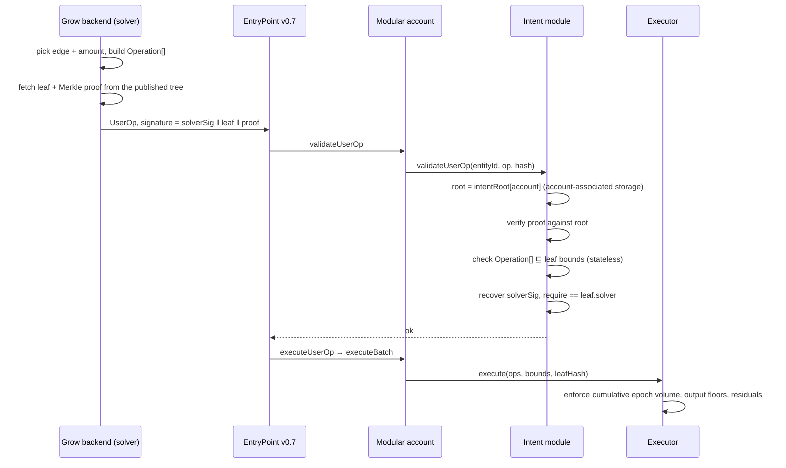

# Design outline: Merkle-committed intents

**Status: proposal, not implemented.** This outlines replacing per-venue, owner-signed on-chain
configuration with a single owner signature over a Merkle root whose leaves are pre-authorized,
bounded state transitions. Grow's backend then proves any automated action is a witness to that
root.

Read alongside [`ARCHITECTURE.md`](ARCHITECTURE.md), which describes the deployed model this
would replace at the validation layer. The registry, adapters, and risk guardian are unaffected.

---

## 1. What this actually buys

The current model costs the user an **on-chain, owner-signed transaction per configuration
decision**:

| Today | Cost to the user |
|---|---|
| Install the Grow entity | 1 owner-signed UserOp |
| Select a registry | 1 owner-signed UserOp |
| Authorize each venue's limits (`setVaultPolicy`) | 1 owner-signed UserOp **per venue** |
| Grow supports a new protocol (new registry) | 1 owner-signed UserOp, **for every user** |
| Grow adds a venue the user wants | 1 owner-signed UserOp, per user |

That last pair is the real problem. A venue expansion or registry migration is an O(users)
re-consent campaign, and users who never re-sign silently stop benefiting.

A Merkle commitment collapses all of it into **one signature that describes the shape of what
Grow may do, rather than enumerating the instances**. The user signs once; the backend proves
membership per action.

**What it does not buy.** It does not remove the backend's per-action signature. The backend
still chooses timing and amounts, so it still signs every UserOperation. The amortization is of
the *user's* authority, not the operator's. Framing it as "one signature replaces millions of
signatures" overstates it; "one signature replaces the entire on-chain policy surface, including
venues that do not exist yet" is the accurate claim, and is worth more.

---

## 2. The commitment

One EIP-712 struct, signed by the account owner:

```solidity
struct IntentCommitment {
    address account;          // binds the root to one smart account
    address executor;         // binds it to one executor deployment
    bytes32 intentRoot;       // Merkle root over authorized transitions
    uint48  validAfter;
    uint48  validUntil;       // mandatory, bounded (see §7)
    uint64  commitmentNonce;  // monotonic; bumping invalidates earlier roots
    // human-readable mirror, rendered by the wallet (see §9.4)
    address asset;            // the single underlying this commitment governs
    uint256 maxPerEpoch;      // aggregate ceiling across every leaf
    uint32  leafCount;
}
```

Domain separation comes from EIP-712 (`chainId`, `verifyingContract` = the module), so a
commitment cannot be replayed onto another chain or another module deployment. `account` and
`executor` are in the struct so it cannot be replayed onto another account or executor either.

The root is registered on-chain once, in the module, via the account's own owner path — the same
`msg.sender == account` trick the current `setAccountRegistry` uses, which the policy library
already makes unreachable to session keys:

```solidity
function setIntentRoot(bytes32 root, uint48 validAfter, uint48 validUntil) external;
```

Registering at `onInstall` time means onboarding stays **one** transaction total.

---

## 3. Leaves: the crux of the design

A leaf must be a *bounded template*, not a fixed calldata hash. Amounts and timing are not known
when the user signs, so a leaf authorizes a region of the action space and the on-chain verifier
checks the concrete operation falls inside it.

Three leaf kinds, each domain-separated so one can never be reinterpreted as another:

### 3.1 `EDGE` — a bounded transition between two named venues

The workhorse. One leaf per authorized rebalance edge.

```solidity
struct EdgeIntent {
    address fromVault;        // address(0) = enter from idle asset
    address toVault;          // address(0) = exit to idle asset
    address asset;            // underlying both legs must share
    uint256 maxAmountPerUse;
    uint256 maxAmountPerEpoch;
    uint48  epochDuration;
    uint16  minOutBps;        // floor relative to adapter preview
    uint48  notBefore;
    uint48  notAfter;
    uint32  maxUses;          // 0 = unbounded within the epoch ceiling
    address solver;           // authorized submitter; 0 = any installed policy owner
}
```

A user with 6 venues and a full rebalance graph signs ~30 leaves (depth-5 tree, 160-byte proofs).
Consent is per-venue and per-direction, exactly as tight as today.

### 3.2 `CLASS` — a predicate over venues, so new venues need no new signature

This is what removes the O(users) re-consent campaign.

```solidity
struct ClassIntent {
    address registry;         // venue must be admitted by this registry
    uint8   protocolMask;     // bitmask over the Protocol enum
    address asset;
    uint256 maxAmountPerUse;
    uint256 maxAmountPerEpoch;
    uint48  epochDuration;
    uint16  minOutBps;
    uint48  notBefore;
    uint48  notAfter;
    address solver;
}
```

The verifier resolves the concrete vault through `registry.venue(vault)` and checks the venue is
admitted, its protocol is in the mask, and its asset matches. Any venue governance admits later
is automatically in scope.

**This is the central trust decision of the whole proposal.** A `CLASS` leaf delegates venue
selection to the registry owner. It buys frictionless expansion and pays for it by widening what
a compromised registry owner can reach — from "nothing, without each user's fresh signature" to
"any factory-authenticated venue of the named protocols, within the signed amount ceiling."
Pinning `registry` keeps that bounded to one immutable, append-only registry; scoping by protocol
and asset bounds it further. It does not eliminate it. Offer both kinds and let product decide
per user segment; do not silently default users into `CLASS`.

### 3.3 `EXACT` — one fully-specified operation

```solidity
struct ExactIntent {
    bytes32 opHash;           // keccak of the exact Operation[] the account may run
    uint48  notBefore;
    uint48  notAfter;
    address solver;
}
```

For scheduled one-off moves ("exit everything on 2026-12-01"). Consumed once (§5).

### 3.4 Leaf hashing

Use OpenZeppelin's `StandardMerkleTree` convention — **double-hashed leaves and sorted internal
pairs**:

```solidity
bytes32 leaf = keccak256(bytes.concat(keccak256(abi.encode(LEAF_KIND_TYPEHASH, kind, spec))));
```

Double hashing is what prevents second-preimage attacks, where an internal node is presented as
a leaf. Sorted pairs remove the need to transmit index bits. Including `kind` inside the hashed
preimage prevents cross-kind reinterpretation. These are not optional stylistic choices; each one
closes a known Merkle bug class.

---

## 4. Verification flow, and the ERC-4337 constraint that shapes it



**The constraint.** ERC-7562 restricts what an unstaked validation module may read during
validation to *account-associated* storage — slots of the form `keccak(account ‖ X) + n`. A
`mapping(address account => bytes32)` root qualifies. A **nested** `mapping(address =>
mapping(bytes32 => uint256))` leaf-usage counter does **not** — its slot is
`keccak(leafHash ‖ keccak(account ‖ slot))`, which is outside the associated range. The existing
module already documents this constraint for its owner array.

So the work splits, and it splits along the same seam the deployed system already uses:

| Phase | Enforces | Why there |
|---|---|---|
| Validation (module) | proof ∈ root; venue scope; direction; per-use cap; `minOutBps`; time window; solver identity | All stateless or account-associated; no executor storage read |
| Execution (executor) | cumulative epoch volume per leaf; preview-relative and absolute output floors; residuals; adapter code hash | Storage rules do not apply after validation |

Attempting cumulative accounting inside validation would force the module to be staked, or to
squeeze usage counters into a fixed-size array inside the per-account struct (capping how many
leaves can be rate-limited at once). Both are worse than putting it in the executor.

### 4.1 Why the executor can trust caller-supplied bounds

`execute(Operation[] ops, IntentBounds bounds, bytes32 leafHash)` looks like it lets a caller
invent its own budget. It is safe, because of an invariant the executor already has: **every
transfer is `from msg.sender` and every output is credited to `msg.sender`.** An account calling
`execute` directly can only move its own funds, so self-chosen bounds harm nobody else. The
budget exists solely to bound what a *session key* may do on the account's behalf, and the session
key's path runs through module validation, which pins `bounds` to `leafHash` and `leafHash` to the
user-signed root.

State this invariant in the executor's NatSpec; it is the load-bearing reason the split works.

---

## 5. Replay and consumption

Anti-replay is **not** the leaf's job. EntryPoint already provides per-key sequential nonces, and
the Grow entity has its own nonce key. A leaf is an authorization scope, reusable by design.

Two consumption semantics, selected per leaf kind:

- **Renewable** (`EDGE`, `CLASS`): bounded by `maxAmountPerEpoch` in the executor, keyed by
  `(account, leafHash)`. One leaf serves unbounded actions over time. This is where "thousands of
  actions per signature" actually comes from — renewal, not tree size.
- **One-shot** (`EXACT`, or any leaf with `maxUses != 0`): a use counter, also
  `(account, leafHash)` in the executor.

A deliberate consequence: a leaf's budget bucket is keyed by leaf hash, so **re-signing a
commitment with the same leaf content resumes the same bucket**, and changing any bound starts a
fresh one. Document it; it is the kind of thing that surprises operators during an incident.

---

## 6. Proof size and cost

Sorted-pair proof of depth `d` costs `32d` calldata bytes plus `d` keccaks.

| Leaves | Depth | Proof bytes | Notes |
|---|---|---|---|
| 32 | 5 | 160 | typical `EDGE` set for one user |
| 1 024 | 10 | 320 | large enumerated venue set |
| 1 048 576 | 20 | 640 | only needed if leaves are one-shot per action |

Calldata is the dominant cost on an L2, and it counts against the module's immutable
`maxPreVerificationGas` ceiling. This is the concrete argument for renewable leaves over
pre-enumerating every future action: depth 5 with renewal beats depth 20 without it on every axis.

If a single UserOp ever needs two leaves, use OpenZeppelin's `multiProofVerify` rather than two
independent proofs — it shares internal nodes.

---

## 7. Revocation and expiry

| Control | Latency | Mechanism |
|---|---|---|
| Narrow or replace authority | 1 owner-signed tx | `setIntentRoot(newRoot, …)` |
| Revoke everything | 1 owner-signed tx | `setIntentRoot(bytes32(0), …)` |
| Revoke one solver | 1 owner-signed tx | `removeOwner` (existing) |
| Full uninstall | 1 owner-signed tx | uninstall the Grow entity (existing) |
| Passive expiry | none | `validUntil` on the commitment |
| Deposit-side venue freeze | none (Grow-side) | risk guardian `pauseVaultDeposits` (existing) |

`validUntil` must be **mandatory and capped** — reject a commitment whose window exceeds, say, 90
days. Authority that expires by default is the safe default; a perpetual root is a perpetual
liability, and periodic re-signing is a natural checkpoint for the user to review scope.

Note the regression versus today: revocation becomes **root-level, not per-venue**. Zeroing one
venue's limit currently costs one call; under a single root it means publishing a new tree.
Mitigate by grouping leaves so a narrowing re-sign is cheap to compute, or by keeping a small
on-chain per-venue deny-list the account can add to in one call.

---

## 8. What changes in the current stack

| Component | Change |
|---|---|
| `GrowYieldPolicyModule` | Replaced by an intent module: stores `intentRoot`/window per account instead of enumerating policy owners' permissions; validation becomes proof + bounds check |
| `GrowYieldPolicyLib` | Keep the canonical `approve / execute / revoke` batch-shape check as defence in depth; the leaf now supplies *scope*, the library still supplies *shape* |
| `GrowYieldExecutor` | `setVaultPolicy` / `resetVaultPolicy` / `vaultPolicy` give way to leaf-keyed budgets seeded from signed bounds; `execute` gains `(bounds, leafHash)`; everything else (floors, residuals, code-hash pin, pauses) unchanged |
| `GrowYieldAdapterRegistry` | Unchanged. `CLASS` leaves read `venue(vault)` from it |
| Adapters | Unchanged |
| Risk guardian | Unchanged, and now the only Grow-side control that does not need a user signature |

Keeping the batch-shape library matters: it is what guarantees allowances are granted and revoked
inside the same batch, which no leaf bound expresses.

---

## 9. Security analysis

### 9.1 Merkle-specific
- **Second preimage / node-as-leaf.** Closed by double-hashed leaves.
- **Cross-kind confusion.** Closed by committing `kind` inside the leaf preimage.
- **Unbalanced-tree duplicate leaves.** Use a standard tree builder; do not hand-roll padding.
- **Proof-length griefing.** Cap proof depth on-chain; an unbounded proof is unbounded validation
  gas.
- **Tree availability.** The tree is off-chain. If the backend loses it, automation stops until
  the user re-signs. It is operational state that must be backed up and, ideally, published so
  anyone can reconstruct proofs.

### 9.2 Leaf specification
The dangerous failure is not a broken proof, it is a **correct proof of an overly broad leaf**. A
leaf with `maxAmountPerEpoch = type(uint256).max`, or a `CLASS` leaf with a full `protocolMask`
and no `notAfter`, is a blank cheque that verifies perfectly. Mitigations:
- Reject `type(uint256).max` amounts and zero-duration epochs at verification time, mirroring the
  executor's existing `UnboundedPolicy` guard.
- Require `notAfter != 0` and within the commitment window.
- Make the leaf encoder a single reviewed library shared by backend and tests, never
  hand-assembled per caller.
- Property-test the encoder against the on-chain verifier: any leaf the backend can build must
  decode to identical bounds on-chain, and any operation the verifier accepts must satisfy the
  bounds the encoder claims.

### 9.3 Solver authority
A leaf naming `solver == address(0)` (any policy owner) is fine. A leaf naming *no* signer at all
— permissionless execution of authorized transitions — is not: an adversary could execute a
technically-in-bounds rebalance at a deliberately bad moment, burning budget and realizing
slippage up to `minOutBps`. **Always require a signature from an authorized solver.** The user's
signature is what is amortized; the operator's is not.

### 9.4 Blind signing — the underrated risk
"Sign this Merkle root" is unreadable, and an unreadable signature is the ideal phishing payload.
Two mitigations, both necessary:
1. **Human-readable mirror fields in the signed struct** (`asset`, `maxPerEpoch`, `leafCount`,
   `validUntil`), so the wallet renders meaning rather than a hash. The verifier must then check
   the mirror against the leaves it accepts — an aggregate ceiling no single leaf may exceed —
   otherwise the mirror is decorative and actively misleading.
2. **Publish the tree** at signing time so the user's client, or a third party, can independently
   enumerate exactly what was authorized.

A mirror field that is signed but unenforced is worse than none: it tells the user a bound that
the contract does not hold them to.

### 9.5 Observability
- Emit `leafHash` (indexed), vault, direction, amount in, amount out per execution. Triage starts
  from "which leaf authorized this."
- Metric per leaf kind and per validation-failure cause (bad proof, out of window, over per-use
  cap, wrong solver, unknown venue). High-frequency, so metrics not logs.
- Alert on validation-failure rate by cause: a spike in "bad proof" means the backend's tree is
  stale, which is an availability incident, not a security one — and distinguishing those quickly
  matters.
- Alert on cumulative epoch consumption approaching a leaf's ceiling, per account.

---

## 10. Honest assessment

**Adopt if** venue expansion without per-user re-consent is a product requirement. That is the
one thing the current architecture genuinely cannot do, and no amount of tuning fixes it.

**Do not adopt for** signature-count reduction alone. The backend signature per action remains, so
per-action cost barely moves; onboarding drops by a few transactions, and per-op calldata rises by
the proof.

**Net complexity: higher.** It trades a small amount of well-understood on-chain state
(`_policies[account][vault]`, set by an owner-signed call) for a new consensus-critical
specification (the leaf schema and its encoder) plus safety-critical off-chain state (the tree).
The current design's best property is that *nothing* is authorized unless the user signed for that
exact venue; `CLASS` leaves knowingly relax that in exchange for scale. That relaxation, not the
cryptography, is the decision to make.

**Scope beyond yield.** The authorization layer generalises to swaps and bridging; the leaf
schema and the executor do not. See §14 — three of those decisions are cheap now and very
expensive to retrofit.

**Suggested sequencing.** Ship `EDGE` and `EXACT` leaves first — they are strictly equivalent in
authority to today's per-venue limits, so they carry the crypto and the plumbing with no change to
the trust model. Add `CLASS` only once the `EDGE` path has been audited and run in production, and
gate it per account.

---

## 11. Prior art worth evaluating before building bespoke

This pattern is well-trodden; a bespoke scheme should be a deliberate choice, not a default.
Details below need verification against current versions — treat as pointers, not specifications:

- **ERC-7579 smart sessions** (Rhinestone) — session configuration with enable-signatures and, in
  some variants, Merkle-rooted session specs. Closest published analogue to this design.
- **ERC-7715 `wallet_grantPermissions`** — a draft standard for a wallet granting scoped
  permissions to a dapp/operator. Aligning the leaf schema with its permission vocabulary would
  make Grow's authority legible to wallets rather than opaque.
- **Permit2 witness (`permitWitnessTransferFrom`)** — the established pattern for binding extra
  signed data to a transfer authorization.
- **Safe allowance module** — the simplest existing "recurring bounded authority" model, useful as
  a baseline to justify the added complexity against.
- **OpenZeppelin `MerkleProof` / `StandardMerkleTree`** — use these rather than hand-rolling; the
  JS builder and the Solidity verifier are designed to agree.

Adopting an emerging standard would also make the wallet-side rendering problem in §9.4 somebody
else's solved problem rather than Grow's bespoke one.

---

## 12. Open questions

1. **`CLASS` scope.** Should a class leaf pin one registry (bounded trust, breaks on registry
   migration) or accept any registry authorizing the executor (survives migration, delegates venue
   admission entirely to Grow governance)? This determines whether the O(users) re-consent problem
   is actually solved or merely deferred.
2. **Per-venue revocation.** Is root-level revocation acceptable, or is a one-call per-venue
   deny-list required?
3. **Commitment lifetime cap.** 30, 90, or 180 days? Shorter is safer and costs more signing
   prompts.
4. **Aggregate ceiling enforcement.** Is `maxPerEpoch` in the mirror enforced across all leaves
   (needs a second budget bucket keyed by commitment) or only per leaf?
5. **Solver set.** Keep the existing policy-owner set as the solver allowlist, or name solvers per
   leaf? Per-leaf is finer but multiplies the tree.
6. **Standard vs bespoke.** Is aligning with ERC-7579 smart sessions / ERC-7715 acceptable given
   the pinned Alchemy Modular Account v2.0.1 target?

---

## 13. Relationship to the in-flight refactor

The monomorphic-adapter work (one adapter per protocol, venue-keyed registry, `Operation.vault`)
is **orthogonal and complementary**. It makes a venue a first-class address with a registry-pinned
`(asset, positionToken)` pair, which is exactly the handle a `CLASS` leaf needs to express "any
USDC venue of protocol P admitted by registry R". Finishing that refactor first makes this design
simpler, not harder.

---

## 14. Generality beyond yield: swaps, bridging, and other capabilities

The design has three layers, and **only the first is action-agnostic**.

| Layer | Generic? |
|---|---|
| Authorization — root, proof, solver signature, window, EIP-712 commitment | **Yes.** Says nothing about what the action is |
| Constraint language — the leaf schema | **No.** `EdgeIntent` assumes one asset and an `(asset, positionToken)` pair; `Venue` and `IYieldAdapter` likewise |
| Execution and settlement — the executor | **No.** Four assumptions below, and not all action classes satisfy them |

### 14.1 The four assumptions the executor rests on

1. An action has exactly one input token and one output token.
2. Output is measurable in the same transaction, as a balance delta on `msg.sender`.
3. The venue can be asked on-chain what the output *should* be (`previewDeposit` / `previewRedeem`
   / `exchangeRateStored`), independently of the caller's claim.
4. The adapter needs no caller-supplied free-form data.

| Capability | 1-in/1-out | same-tx measurable | independent quote | no free-form data |
|---|---|---|---|---|
| Yield enter / exit | yes | yes | yes | yes |
| Swap (on-chain route) | yes | yes | **no** | **no** (route) |
| Swap (RFQ / solver fill) | yes | yes | **no** | **no** (quote blob) |
| Bridge | yes | **no** | no | no |
| LP join | **no** (n-in) | yes | partial | partial |
| Claim rewards | **no** (0-in) | yes | no | partial |

### 14.2 Swaps escalate trust in the operator

The effective floor today is `max(preview × (10_000 − maxLossBps) / 10_000, minAmountOut)`. The
`preview` term is what makes a compromised adapter or backend unable to misprice: the expectation
comes from the venue, not from any caller. A DEX offers no such independent expectation, so for a
swap the term collapses and the only floor is `minAmountOut` — **chosen by the solver**.

That moves the backend from "arithmetically unable to misprice" to "able to extract up to the
leaf's slippage bound, at a moment of its choosing." Recoverable only by introducing an
independent price source with its own deviation bound, evaluated against the *leaf*, not against
the solver's quote. That is a new trusted dependency and must be planned for as one, not treated
as a free extension of the existing loss cap.

### 14.3 Bridging breaks same-transaction settlement, and belongs elsewhere

`receivedOut = outputToken.balanceOf(msg.sender) - outputBefore` is the executor's core safety
property, and it is unmeasurable for an asynchronous cross-chain action. The property degrades
from *enforced atomically* to *recorded, then reconciled*: non-delivery becomes detectable and
alertable, not revertable.

Bridging should therefore **not share this executor.** It wants a separate settlement contract
with an obligation/attestation model (optimistic, oracle, or light-client verified), per-
destination allowlists, tighter ceilings than same-chain actions, a mandatory off-chain
reconciliation job, and its own kill switch. Share the authorization layer; do not share the
execution path.

### 14.4 What generalises the other two layers

**Capability-typed leaves.** A leaf commits `(capability, keccak(bounds))`, with a bounds codec
and verifier branch per capability. Adding a capability changes neither the commitment format nor
any root already signed.

Two rules are non-negotiable:
- An **unrecognised capability must fail closed**, so an older verifier can never be induced to
  honour a newer leaf kind.
- The commitment carries a **`schemaVersion`** the module rejects if it does not implement.
  Retrofitting this later means invalidating every root users have signed.

**A declared balance-delta obligation** in place of the yield-shaped `Operation`:

```solidity
struct Action {
    uint8     capability;   // YIELD_ENTER | YIELD_EXIT | SWAP | LP_JOIN | CLAIM | ...
    address   venue;        // registry-resolved
    Spend[]   spends;       // (token, maxAmount) pulled from the account
    Receive[] receives;     // (token, minAmount) that MUST land on the account
    bytes     venueData;    // opaque, length-bounded, adapter-interpreted
}
```

The executor then pulls no more than each `spends[i].maxAmount`, calls the adapter, asserts every
`receives[j].minAmount` landed on the account, and asserts zero residuals on the adapter. That
covers 1-in-1-out, n-in-1-out, and 0-in-n-out uniformly.

This is a smaller change than it appears, because **the executor already verifies outcomes rather
than paths** — its residual checks, exact-consumption checks, and output floors are all outcome
assertions. Generalising them is what makes an opaque `venueData` tolerable: a route that cannot be
parsed is acceptable if its effects can be bounded.

One limit to state plainly: outcome verification bounds the *declared* tokens plus adapter-held
balances. It cannot prove an adapter left some unrelated token of the account's untouched. The only
thing preventing that is the account never carrying a standing allowance — precisely what
`GrowYieldPolicyLib`'s approve/execute/revoke batch shape guarantees. **In a multi-capability
design that library becomes more load-bearing, not less.**

### 14.5 The cross-chain signature problem

A bridge intent spans chains, but EIP-712 pins `chainId` in the domain. Signing once per chain
defeats the purpose of a single commitment; dropping `chainId` is unsafe when the account address
may differ per chain. The established answer is a chain list committed inside the signed struct,
with leaves naming `dstChainId` explicitly — the multi-chain enable-signature problem that the
ERC-7579 smart-sessions work in §11 already addresses.

### 14.6 Recommendation

Specify the **capability enum**, the **fail-closed version gate**, and the **`Spend[]`/`Receive[]`
shape** now, while implementing only the yield capabilities. All three are cheap today and
expensive to retrofit, the latter two because retrofitting invalidates roots users have already
signed.

Treat swaps as a distinct project with a price-oracle dependency, and bridging as a separate
settlement contract sharing only the authorization layer.
