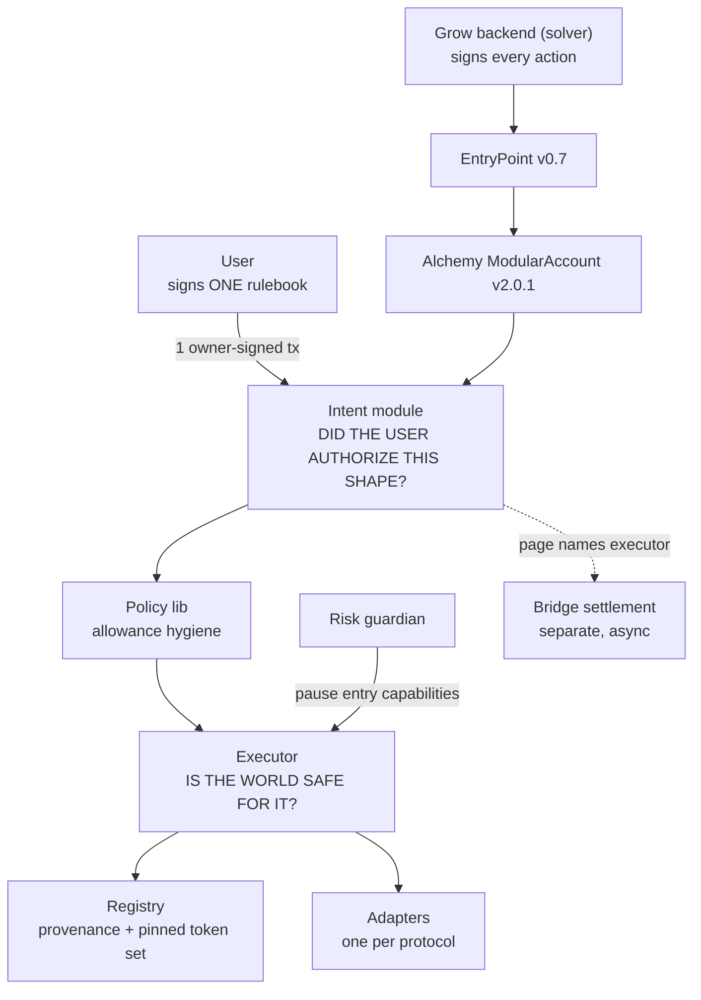

# New architecture: signed rulebooks and a generic executor

**Status: design proposal. Nothing here is implemented.**

Two changes, one document:

1. The user stops granting permissions one on-chain transaction at a time. They sign **one
   rulebook**, and Grow proves each automated action was a page in it.
2. The executor stops being yield-shaped. An action becomes a **declared set of token movements**,
   which makes swaps, LP positions, and reward claims additive rather than rewrites.

The registry, the adapters, and the risk guardian survive largely intact. Read
[`ARCHITECTURE.md`](ARCHITECTURE.md) for the model this replaces, and
[`INTENT-COMMITMENT-DESIGN.md`](INTENT-COMMITMENT-DESIGN.md) for the Merkle layer in more depth.

---

## Scope of the first build

**Only yield rebalancing ships.** Two capabilities, `YIELD_ENTER` and `YIELD_EXIT`, which together
express exactly what the deployed system already does. Everything else in this document is
described so the extension points can be built in now, not so it can be built now.

Bounding scope this way is not only cheaper — it is *strictly safer than the full design*, because
the two parts that widen the trust model are the two parts being deferred:

- `CLASS` pages delegate venue selection from the user's signature to the registry owner. Deferred,
  so authority stays exactly where it is today: nothing is authorized unless the user signed for
  that specific venue.
- `SWAP` needs a price oracle, because a DEX cannot honestly quote itself. Deferred, so every
  venue still self-quotes and the operator-independent output floor survives untouched.

So the first build is **no-worse-than-today on trust**, and cheaper to operate.

### Four extension points that must go in now

Each is cheap today and expensive later. The first three because retrofitting them changes an
EIP-712 typehash and therefore invalidates every rulebook users have already signed; the fourth
because retrofitting it means redeploying the executor and reinstalling the module for every user.

| Keep | Shape in v1 | Why it cannot wait |
|---|---|---|
| `capability` byte in the page | Only `YIELD_ENTER` / `YIELD_EXIT` legal; anything else reverts | Adding a signed field later changes the typehash |
| `schemaVersion` in the commitment | `1`; module rejects anything it does not implement | Same, and it is the only safe way to ever change the page format |
| `executor` in the page, not the commitment | One executor address | Lets one rulebook cover a future async settlement contract |
| `Spend[]` / `Receive[]` in `Action` | Always length 1 | Multi-token actions later would otherwise need a new executor ABI |

Fail-closed is the rule for all four: an unrecognised `capability`, `kind`, or `schemaVersion`
**reverts**. An older verifier must never be talkable into honouring a newer page.

### Deferred, with the field reserved

Reserve the field, constrain it to one legal value, and revert on anything else. That keeps the
signed and ABI shapes stable without building the feature.

| Deferred | v1 constraint |
|---|---|
| `CLASS` pages | `kind ∈ {EDGE, EXACT}` only |
| `quoteSource` / oracles | `ADAPTER_QUOTE` only; `oracle` must be zero |
| `venueData` | Must be empty for yield capabilities |
| Multi-token venues | `MAX_VENUE_TOKENS = 2`; raising it is a redeploy, not a schema change |
| Cross-action chaining | `PREVIOUS_RECEIVE` encoded as `(refAction, refReceive)`, but only the immediately preceding action's single receive is accepted — today's `PREVIOUS_OUTPUT` semantics, future-proof encoding |

Not built at all, and not reserved: `LP_JOIN`, `LP_EXIT`, `CLAIM`, `BRIDGE_SEND`, and the bridge
settlement contract. They need only a new `capability` value, which the reserved byte already
allows.

### What the scoped version does and does not buy

Be precise here, because the headline benefit changes once `CLASS` is deferred.

**It buys:** onboarding drops from `2 + N` owner-signed transactions (install, select registry, one
per venue) to **one**. And with calldata root rotation (§4.1), a venue expansion costs the user
**one off-chain signature and zero transactions** — no gas, no UserOperation, no bundler, and it
can ride along with any normal app interaction.

**It does not buy:** venue expansion still needs *something* from every user. `EDGE` pages name
venues explicitly, so a new venue means a new rulebook. The re-consent problem shrinks from "every
user must send a transaction" to "every user must sign a message" — a large practical improvement,
but not elimination. Eliminating it is what `CLASS` is for, and that is exactly the trade being
deferred.

---

## 1. The one idea that organizes everything

Every check in this system answers one of exactly two questions:

> **"Did the user authorize this shape of action?"** — answerable from the signature alone.
> Nothing on-chain needs to be consulted.

> **"Is the world currently in a state where this action is safe?"** — needs live on-chain state:
> balances, prices, whether a venue is still real.

Those two questions belong in different places, and not for tidiness. ERC-7562 restricts what a
validation module may read while a UserOperation is being validated: essentially only storage
slots of the form `keccak(account ‖ X) + n`. A module cannot read the registry, cannot read the
executor, cannot read a running total from a nested mapping.

So:

| Question | Answered by | Reads |
|---|---|---|
| Did the user authorize this shape? | **Intent module**, during validation | Only the account's own root. Everything else is pure computation |
| Is the world safe for it right now? | **Executor**, during execution | Registry, balances, quotes, budgets — no restrictions after validation |

Every design decision below follows from that split. When something feels arbitrarily placed, it
is almost always because of this rule.

---

## 2. One action, end to end

A concrete rebalance, so the layers have something to hang on.

**Setup, once.** The user signs a rulebook. One page of it reads, in effect:

> *Move USDC out of the Aave venue and into the Morpho venue. At most 500 USDC per move, 2,000
> per day. Lose no more than 0.5% versus what the venue itself quotes. Valid until 1 October.
> Only Grow's backend key may do this.*

The rulebook has ~30 such pages. Only a 32-byte fingerprint of it goes on-chain, stored against
the account. This is the account's **one** owner-signed transaction.

**Later, thousands of times.**

1. The backend decides to move 400 USDC from Aave to Morpho.
2. It fetches that page and a short proof (5 hashes) that the page belongs to the signed rulebook.
3. It builds a batch: `approve(USDC) → executor.execute(actions) → approve(USDC, 0)`, signs the
   UserOperation, and submits it.
4. **Intent module** checks: the proof matches the stored fingerprint; the action is a
   `YIELD_EXIT` then `YIELD_ENTER` between the two venues the page names; 400 ≤ the 500 per-move
   cap; today is before 1 October; the signature is the backend's. All pure computation.
5. **Policy lib** checks the batch grants an allowance for exactly USDC — the token the action
   declares it will spend — and revokes it in the same batch. No standing approval survives.
6. **Executor** resolves each venue in the registry, confirms the venue permits that capability
   and isn't paused, confirms the adapter's code hash is the one admitted, asks the venue what
   400 USDC *should* produce, moves the money, then asserts the account actually received at least
   `quote × 99.5%`, that the adapter kept nothing, and that today's 2,000 USDC budget isn't
   exceeded.
7. Emits the leaf hash alongside every token delta, so an operator can always answer "which page
   authorized this?"

Steps 4 and 5 are "did the user authorize this?". Step 6 is "is the world safe for it?".

---

## 3. Why a rulebook instead of a list of permissions

Today the user pays one on-chain, owner-signed transaction per permission granted:

| Today | Cost |
|---|---|
| Install the Grow entity | 1 tx |
| Select a registry | 1 tx |
| Authorize each venue's limits | 1 tx **per venue** |
| Grow supports a new protocol | 1 tx, **per user, for every user** |

The last row is the real problem. A venue expansion becomes a re-consent campaign, and users who
never re-sign quietly stop benefiting.

A rulebook collapses all of it into one signature that describes **the shape of what Grow may
do**, rather than enumerating instances.

Three honest caveats, stated up front because they are easy to gloss over:

**The backend still signs every action.** It chooses timing and amounts, so it must. What got
amortized is the *user's* authority, not the operator's. "One signature replaces a million
signatures" is not the claim; "one signature replaces the user's entire permission-granting
process, including venues that do not exist yet" is.

**Pages are rules, not scripts.** Nobody knows at signing time that the amount will be 400 USDC.
So a page states bounds — a spending limit, not a list of pre-approved purchases. That is also why
you need ~30 pages and not millions: a rule is reusable for months.

**Blind signing is the sharpest risk in the whole design.** A prompt reading *"Sign this:
0x7f3a…"* means nothing to a human, which makes it ideal phishing material. Section 10.1 covers the
mitigation, and it has a trap in it.

---

## 4. The rulebook

One EIP-712 struct, signed by the account owner:

```solidity
struct IntentCommitment {
    address account;          // this account only
    address module;           // this module only (also the EIP-712 verifyingContract)
    uint16  schemaVersion;    // rejected if the module does not implement it
    bytes32 intentRoot;
    uint48  validAfter;
    uint48  validUntil;       // mandatory and capped (§13)
    uint64  commitmentNonce;  // bumping invalidates every earlier rulebook
    // Human-readable mirror, rendered by the wallet — and enforced (§10.1)
    address asset;
    uint256 maxPerEpoch;      // aggregate ceiling across all pages
    uint32  leafCount;
}
```

`chainId` and `verifyingContract` come from the EIP-712 domain, so a rulebook cannot be replayed
onto another chain or module. `account` is in the struct so it cannot be replayed onto another
account.

Note what is **not** here: the executor. It moves into the page (§5), so a single rulebook can
authorize both the atomic executor and the asynchronous bridge settlement contract.

Registered once, through the account's own owner path:

```solidity
function setIntentRoot(IntentCommitment calldata c, bytes calldata ownerSig) external;
```

Keyed by `msg.sender == account`, exactly as the current `setAccountRegistry` is — which the
policy lib already makes unreachable to a session key. Doing it inside `onInstall` keeps onboarding
at **one** transaction total.

### 4.1 Rotating the rulebook without a transaction

Under `EDGE`-only scope, adding a venue means a new rulebook, so rotation is the common path rather
than a rare one. It must not cost the user a transaction.

The module stores a `commitmentSigner` per account at install — the user's owner key — and accepts a
**newer commitment presented in the UserOperation's calldata**:

```solidity
// Accepted during validation when c.commitmentNonce > storedNonce[account]
// and ECDSA-recover(c, ownerSig) == commitmentSigner[account].
```

The user signs off-chain; the backend carries the new commitment in the next automated
UserOperation; the root rotates as a side effect. Monotonic `commitmentNonce` prevents replaying a
superseded rulebook.

Verifying against a stored `commitmentSigner` is deliberate. The alternative —
`IERC1271(account).isValidSignature(...)`, so the account's own owner module decides — is more
faithful to the account's real ownership, but it re-enters the account while the account is mid-
validation. That needs verifying against Alchemy MA v2.0.1's reentrancy behaviour before being
relied on. Stored signer first; ERC-1271 as a later upgrade once tested.

One consequence to accept: rotating the owner key requires re-registering `commitmentSigner`, which
*is* a transaction. Acceptable, because key rotation is rare and already an on-chain event.

---

## 5. Pages

A page authorizes a *region* of the action space. Every page carries a capability, an executor,
bounds, a window, and a solver.

```solidity
struct PageHeader {
    uint8   kind;             // EXACT | EDGE | CLASS
    uint8   capability;
    address executor;         // which settlement contract this page authorizes
    address solver;           // 0 = any installed solver key
    uint48  notBefore;
    uint48  notAfter;
    uint256 maxAmountPerUse;
    uint256 maxAmountPerEpoch;
    address budgetToken;      // the token the epoch budget is measured in
    uint48  epochDuration;
    uint16  maxLossBps;
    uint32  maxUses;          // 0 = unbounded within the epoch ceiling
}
```

Three page kinds, differing only in **how they name the venue**:

### `EDGE` — names venues explicitly

```solidity
struct EdgePage { PageHeader h; address fromVenue; address toVenue; }
```

Authority identical to today's per-venue limits. A new venue still needs a new rulebook. Safe,
familiar, and the right thing to ship first.

### `CLASS` — describes venues by predicate

```solidity
struct ClassPage {
    PageHeader h;
    address registry;         // venue must be admitted here
    uint32  protocolMask;
    uint32  capabilityMask;
    address asset;
}
```

Any venue governance admits later is automatically in scope, so venue expansion stops requiring
per-user signatures.

**This is the central trust decision of the entire proposal.** A `CLASS` page delegates venue
selection from the user's signature to the registry owner. It moves the reachable set from
"nothing without this user's fresh signature" to "any factory-authenticated venue of the named
protocols, within the signed ceiling". Pinning `registry` bounds that to one immutable,
append-only registry; the protocol and asset filters bound it further. It does not eliminate it.
Offer both kinds; never silently default a user into `CLASS`.

**Where a `CLASS` page gets checked is forced by §1.** Resolving a venue requires reading the
registry, which the module may not do during validation. So the check splits:

- Module (validation): the page is a `CLASS` page, and the action's amounts, capability, window,
  and solver satisfy its header. Pure computation.
- Executor (execution): the venue really is admitted by `page.registry`, its protocol is in
  `protocolMask`, its asset matches. Reads live registry state.

Both halves are necessary. Neither can move.

### `EXACT` — one fully-specified action

```solidity
struct ExactPage { PageHeader h; bytes32 actionsHash; }
```

For scheduled one-offs — "exit everything on 1 December". Consumed once via `maxUses = 1`.

### Page hashing

OpenZeppelin `StandardMerkleTree` convention: **double-hashed leaves, sorted internal pairs.**

```solidity
bytes32 leaf = keccak256(bytes.concat(keccak256(abi.encode(PAGE_TYPEHASH, kind, page))));
```

Double hashing prevents an internal node being presented as a leaf. Sorted pairs remove index
bits. Committing `kind` inside the preimage prevents cross-kind reinterpretation. Each of the
three closes a known Merkle bug class; none is stylistic.

**Unknown `kind` or `capability` must revert.** An older verifier must never be talkable into
honouring a newer page. Same for `schemaVersion`. Retrofitting this later invalidates every
rulebook already signed, which is why it goes in on day one.

---

## 6. The generic action

The executor's current `Operation` assumes one input token, one output token, and a venue that can
quote itself. Swaps, LP positions, and claims each break one of those. The generalization is to
stop describing *what kind of operation* it is and start describing **which tokens move**.

```solidity
struct Action {
    uint8     capability;
    address   venue;
    Spend[]   spends;         // tokens leaving the account
    Receive[] receives;       // tokens that MUST arrive at the account
    bytes     venueData;      // length-bounded, adapter-interpreted
}

struct Spend {
    address    token;
    uint256    amount;
    AmountMode mode;          // EXACT | FULL_BALANCE | PREVIOUS_RECEIVE
    uint8      refAction;     // PREVIOUS_RECEIVE only
    uint8      refReceive;    // PREVIOUS_RECEIVE only
}

struct Receive {
    address token;
    uint256 minAmount;        // absolute solver-signed floor
}
```

What this buys:

| Shape | Example | Possible today? |
|---|---|---|
| 1-in / 1-out | yield enter, yield exit, swap | yes |
| n-in / 1-out | LP join with two tokens | no |
| 0-in / n-out | claim rewards | no |
| chained across assets | exit USDC vault → swap to USDT → enter USDT vault | no |

The last row is why `PREVIOUS_OUTPUT` becomes `PREVIOUS_RECEIVE` with an explicit
`(action, receive)` reference. Today's version can chain only one unnamed output, which is enough
for same-asset rebalancing and nothing else. References must point strictly backwards and carry
only **measured** amounts.

### Why opaque `venueData` is tolerable

A swap route cannot be enumerated in advance, so some actions need bytes the executor cannot
parse. That sounds like it destroys the current design's best property — that nothing unvalidated
reaches the venue.

It doesn't, because **the executor already verifies outcomes rather than paths.** Its residual
checks, exact-consumption checks, and output floors are all assertions about end state. Generalize
them and an unparseable route is fine, because its *effects* are bounded.

One limit, stated plainly: outcome verification bounds the declared tokens and the adapter's
balances. It cannot prove an adapter left some unrelated token of the account's alone. The only
thing that prevents that is the account never carrying a standing allowance — which is exactly
what the policy lib guarantees. **In a multi-capability system the policy lib becomes more
load-bearing, not less.**

---

## 7. The layers



| Layer | Guarantees | Deliberately does not know |
|---|---|---|
| Account | Which validation entity runs, and for which selectors | Anything about yield |
| Intent module | Signed by the user, in-window, under per-use caps, by a named solver | Running totals, live venue state |
| Policy lib | Allowances match declared spends exactly, revoked in the same batch | Which venues are permitted |
| Executor | Declared tokens moved as declared, nothing retained, floors met, budgets bounded | Whether the user consented |
| Registry | Venue is a genuine protocol deployment, admitted by Grow, with a pinned token set | Who may use it, or how much |
| Adapters | How to talk to one protocol | Which venues are permitted, and by whom |

### 7.1 Intent module

Replaces `GrowYieldPolicyModule`. Per-account state, all in account-associated slots:
`intentRoot`, window, `schemaVersion`, solver set.

Keeps the existing UserOperation envelope constraints — gas ceilings, pinned paymaster, no
`initCode`, exact-length signature. Those are orthogonal to authorization and still needed.

Adds: proof verification, page decoding, and a stateless bounds check against the decoded
`Action[]`. Reads nothing but the account's own root. That property should be asserted in a test,
not just documented.

### 7.2 Policy lib

Survives, narrows, and gets sharper. It stops carrying policy and becomes purely **allowance
hygiene**: the batch must be

```
approve(t, executor, max) …k times   →   executor.execute(actions)   →   approve(t, executor, 0) …k times
```

where the `k` tokens are exactly the union of `action.spends[].token`, in first-appearance order.
Previously that set was hardcoded to "declared source tokens"; now it is derived from the action,
so the check is strictly more precise.

One nice accident: the lib's canonicality check is decode, re-encode, compare hashes. That
generalizes to dynamic types unchanged. The `args.length == 64 + n × 192` guard for fixed-size
tuples gets dropped — the re-encode comparison was always the stronger of the two.

### 7.3 Registry

Generalizes along exactly one axis: from a fixed `(asset, positionToken)` pair to a **pinned,
exhaustive token set** plus a capability mask.

```solidity
struct Venue {
    address     adapter;
    uint32      capabilityMask;   // which capabilities may target this venue
    uint8       tokenCount;
    address[MAX_VENUE_TOKENS] tokens;   // exhaustive: nothing else may move
    QuoteSource quoteSource;      // ADAPTER_QUOTE | ORACLE
    address     oracle;           // required when quoteSource == ORACLE
}
```

Two things fall out for free:

- **`canDeposit` / `canRedeem` were already a capability mask.** `YIELD_ENTER` and `YIELD_EXIT`
  become two bits. No special-casing, and directional gating generalizes at zero cost.
- **The exhaustive token set is what makes generic outcome verification possible.** The executor
  knows the complete list of tokens that may legitimately move, so it can assert deltas across all
  of them.

Everything else stays: append-only admission, registrar-proven provenance per protocol, code-hash
pinning per adapter, `Ownable2Step` governance that can renounce when the venue set is final. The
venue *identifier* remains protocol-defined — an Aave venue is still its underlying asset, and its
token set is `[USDC, aUSDC]`.

### 7.4 Executor

Loses almost all of its state. Notably it **no longer holds a per-account registry pointer**: the
registry is named in the signed page, so consent and configuration live in one object instead of
two. Onboarding drops another transaction.

That is safe for the same reason caller-supplied bounds are safe, and it is worth spelling out
because it is the invariant the whole split rests on: **every transfer is `from msg.sender` and
every output is credited to `msg.sender`.** A caller invoking `execute` directly can only affect
its own funds, so self-chosen registries and self-chosen bounds harm nobody else. The budget and
registry pinning exist to bound what a *session key* may do on the account's behalf, and the
session key's path is constrained by the module to what the user signed.

Remaining state:

```solidity
mapping(address venue => uint32) public pausedCapabilities;              // guardian
mapping(address account => mapping(bytes32 page => Usage)) private _used; // budgets
```

No owner. Guardian immutable, as today.

### 7.5 Adapters

One per protocol, venue-agnostic, as in the in-flight refactor. Two interface changes:

```solidity
function tokensOf(address venue) external view returns (address[] memory);
function quote(address venue, uint8 capability, Spend[] calldata spends, bytes calldata venueData)
    external view returns (uint256[] memory expectedReceives);
function execute(
    address venue, uint8 capability,
    Spend[] calldata spends, Receive[] calldata receives,
    bytes calldata venueData, address receiver
) external returns (uint256[] memory received);
```

`quote` generalizes `previewDeposit` / `previewRedeem`. `tokensOf` backs the drift check.

---

## 8. The settlement check

The executor's entire job, per action. Steps marked ← are today's checks, widened.

```
 1  venue   = registry.venue(action.venue)                       // registry from the page
 2  require capability bit set in venue.capabilityMask            ← replaces canDeposit/canRedeem
 3  require capability bit clear in pausedCapabilities[venue]     ← replaces depositsPaused
 4  require adapter.codehash == registry.adapterCodeHash(adapter) ←
 5  if entry capability: require adapter.tokensOf(venue) == venue.tokens   ← drift check
 6  require every spend and receive token ∈ venue.tokens
 7  if CLASS page: require venue satisfies protocolMask and asset
 8  snapshot account and adapter balances for all declared tokens ←
 9  expected[] = quote from venue.quoteSource
10  pull each spend into the adapter; measure actual, reject fee-on-transfer  ←
11  charge _used[account][page] on page.budgetToken               ← replaces per-vault budget
12  adapter.execute(venue, capability, spends, receives, venueData, receiver = account)
13  assert adapter retained nothing of any declared token (± rounding)      ←
14  assert each receive delta ≥ max(expected[i] × (1 − maxLossBps), minAmount[i])  ←
15  assert no declared token left the account beyond what step 10 pulled
16  emit(pageHash, venue, capability, all deltas)
```

Step 5 runs on entry capabilities only. That asymmetry is deliberate and inherited: a deposit must
never create a position in a token the registry did not admit, but blocking an *exit* on venue
drift traps the account in the venue that just went bad. Exits stay open as long as the venue
itself permits them.

Step 15 is new and cheap. Over-pulling is already structurally impossible — the account approves
the executor, never the adapter — but with opaque `venueData` in play, asserting it beats reasoning
about it.

### Three upgrades that come free

**Pause becomes exit-safe by construction.** Today "the guardian may pause deposits but never
redemptions" holds because there is one flag and one code path. Generically, the guardian may only
set bits within a compile-time `PAUSABLE_MASK` that excludes every exit capability. A convention
becomes an invariant.

**Quote source becomes explicit, which closes the swap hole.** For yield, `quote` comes from the
venue and is independent of everyone, so `maxLossBps` catches even a compromised solver. A DEX
offers no such honest self-report, so a swap's only floor would be the number the backend itself
picked. Making `quoteSource` a registry-pinned field means a non-quotable venue **must** carry an
oracle, and step 9 takes the floor from the oracle. The hard independent floor survives into swaps
instead of degrading into operator trust.

**The quote requirement scales with what is at risk.** An action that spends nothing — a reward
claim — cannot lose principal, so `minAmount` alone is an adequate floor and no oracle is needed.
Any action that spends requires an independent expectation.

---

## 9. Capability catalogue

Only the first two ship (see Scope). The rest are catalogued so the reserved `capability` byte is
known to be sufficient for them — each needs a new enum value and nothing else in the signed schema.

| Capability | v1 | Spends | Receives | Quote source | Settlement | Needs beyond yield |
|---|---|---|---|---|---|---|
| `YIELD_ENTER` | **yes** | 1 asset | 1 position | adapter | atomic | — |
| `YIELD_EXIT` | **yes** | 1 position | 1 asset | adapter | atomic | — |
| `LP_JOIN` | no | n | 1 | adapter | atomic | budget token must be declared |
| `LP_EXIT` | no | 1 | n | adapter | atomic | per-receive floors |
| `CLAIM` | no | 0 | n | none | atomic | nothing — no principal at risk |
| `SWAP` | no | 1 | 1 | **oracle** | atomic | price oracle; route in `venueData` |
| `BRIDGE_SEND` | no | 1 | 0 here | n/a | **async** | separate contract (§9.1) |

### 9.1 Bridging belongs in a different contract

`receive delta ≥ floor` is the executor's core safety property, and it is unmeasurable when funds
arrive later, possibly on another chain. Enforcement degrades to detection: you can alert on
non-delivery, you cannot revert on it.

So bridging gets its own settlement contract with an obligation/attestation model, per-destination
allowlists, ceilings tighter than same-chain actions, a mandatory off-chain reconciliation job, and
its own kill switch. It shares the authorization layer and nothing else.

**Split executors on settlement model, not on protocol:**

| Contract | Settlement | Capabilities |
|---|---|---|
| `GrowExecutor` | atomic, same transaction, same chain | yield, LP, claim, swap |
| `GrowBridgeSettlement` | obligation recorded, reconciled later | bridge |

This is why the page names its executor and the rulebook does not.

A bridge page also spans chains, which collides with EIP-712 pinning `chainId` in the domain.
Signing once per chain defeats the purpose; dropping `chainId` is unsafe when the account address
may differ per chain. The established answer is a chain list committed inside the signed struct
with pages naming `dstChainId` explicitly — the multi-chain enable-signature problem ERC-7579
smart sessions already handles.

---

## 10. Invariants and where each one lives

Twelve properties, each owned by exactly one layer. If a review cannot point at the owner of a
property, that property is not actually held.

| # | Invariant | Owner |
|---|---|---|
| 1 | No allowance survives the batch | Policy lib |
| 2 | Funds only move from, and to, `msg.sender` | Executor transfer paths |
| 3 | The venue is a genuine protocol deployment | Registry admission |
| 4 | A venue's token set never changes after admission | Registry pin + step 5 drift check |
| 5 | An adapter's code never changes after admission | Code-hash pin |
| 6 | Output meets an operator-independent floor | Quote source + `maxLossBps` |
| 7 | The adapter retains nothing | Residual asserts |
| 8 | Cumulative volume is bounded per page | Executor budgets |
| 9 | The user consented to this shape and these bounds | Merkle proof against the signed root |
| 10 | A named operator is accountable for each action | Solver signature |
| 11 | Exits can never be paused | `PAUSABLE_MASK` excludes exit capabilities |
| 12 | Authority expires by default | Mandatory, capped `validUntil` |

### 10.1 The mirror trap

Invariant 9 is worthless if the user cannot read what they signed. `IntentCommitment` therefore
carries plain-language mirror fields — asset, `maxPerEpoch`, `leafCount`, `validUntil` — for the
wallet to render.

**The mirror must be enforced, not decorative.** `maxPerEpoch` needs a second budget bucket keyed
by the commitment, checked across every page. A bound that is displayed to the user but not
enforced by the contract is worse than displaying nothing: it states a limit that does not exist.

Publishing the tree at signing time is the second half — it lets the user's client, or anyone,
enumerate exactly what was authorized.

---

## 11. Observability

- Emit `pageHash` (indexed), venue, capability, and every token delta per action. Triage starts
  from "which page authorized this".
- Metrics, not logs, for validation failures, split by cause: bad proof, out of window, over
  per-use cap, wrong solver, unadmitted venue, class predicate mismatch.
- Alert on the bad-proof rate specifically. A spike there means the backend's tree is stale — an
  availability incident, not a security one. Distinguishing those two quickly matters more than
  either alert alone.
- Alert on per-account epoch consumption approaching a page ceiling, and on the commitment-level
  aggregate.
- Alert on approaching `validUntil` across the user base; expiry is a silent-degradation risk.

---

## 12. Migration

Yield-only, phased. Each phase is independently shippable and revertible.

| Phase | Work | Verified by |
|---|---|---|
| 1 | Finish the venue-keyed refactor (in flight): one adapter per protocol, venue-keyed registry, `Operation.vault` | Existing suite, already ~90% migrated |
| 2 | Generalize the schema, yield only: `Action`/`Spend`/`Receive`, capability mask, `PAUSABLE_MASK`, generic settlement check, reserved fields | Behaviour-identical, so the existing suite is the oracle |
| 3 | Intent module with `EDGE` + `EXACT` pages, calldata root rotation | New: Merkle fixtures, encoder/verifier property tests, bounds-check differential tests |

Phase 2 is the highest value-per-risk step in the whole plan: it removes the schema as a permanent
constraint while changing no observable behaviour, so the current tests prove it.

Phase 3 runs alongside the existing policy module under a different ERC-6900 entity ID, so adoption
is per-account and reversible. Do not remove the old module until the new path has run in
production.

Deferred to a later decision, not scheduled: `CLASS` pages (§14.1), `SWAP` and its oracle
dependency, and `BRIDGE_SEND` with its separate settlement contract.

### 12.1 Encoder and verifier must be tested against each other

The dangerous failure in phase 3 is not a broken proof — it is a **correct proof of an
overly-permissive page**. A page with `maxAmountPerEpoch = type(uint256).max` verifies perfectly.

Three guards, all in phase 3:

1. Reject `type(uint256).max` amounts, zero `epochDuration`, and zero `notAfter` at verification
   time, mirroring the executor's existing `UnboundedPolicy` guard.
2. One reviewed encoder library, shared by backend and tests. Never hand-assemble a page.
3. Property tests in both directions: every page the encoder can build must decode to identical
   bounds on-chain, and every action the verifier accepts must satisfy the bounds the encoder
   claims.

## 13. Cost and honest assessment

Scoped to yield, the calculus is much simpler than for the full design.

**Phases 1–2 are worth doing regardless of whether phase 3 ever ships.** They cost little, change
no behaviour, and are verified by the tests that already exist. Their whole value is removing the
schema as a future blocker.

**Phase 3 is worth doing if** onboarding transaction count matters, or if `CLASS` is wanted later.
On its own it is close to cost-neutral per action: onboarding drops from `2 + N` transactions to
one, and per-action calldata grows by a Merkle proof (160 bytes at 32 pages).

**Trust does not move.** With `CLASS` and `SWAP` deferred, every invariant in §10 is held by the
same layer, by the same mechanism, as it is today. Nothing is authorized that the user did not sign
for by venue, and every output floor is still operator-independent.

**Costs to plan for.**

- A Merkle proof and dynamic arrays in the validation phase cost more gas than today's fixed
  192-byte tuples, and count against the module's immutable `maxVerificationGas` and
  `maxPreVerificationGas`. Re-derive both from measurements before pinning them in a constructor.
- Revocation becomes root-level rather than per-venue. Consider a one-call per-venue deny-list
  (§14.3); it is small and restores a control that exists today.
- The Merkle tree becomes safety-critical off-chain state. Back it up, and publish it so the tree
  is independently reconstructible.
- Blind signing is the sharpest remaining risk, and §10.1's mirror fields are the mitigation — with
  the trap that a displayed-but-unenforced bound is worse than none.

**Net complexity: higher, but bounded.** Phase 3 trades a small amount of well-understood on-chain
state for one new consensus-critical artefact — the page schema and its encoder — plus off-chain
tree management. That is a real cost. It is a much smaller cost than the full design, because the
page schema in scope has two capabilities and two page kinds.

## 14. Open decisions

Only the first three block the scoped build. The rest are recorded so they are not rediscovered
later.

### Blocking

1. **Commitment lifetime cap.** 30, 90, or 180 days? Shorter is safer; each expiry costs the user a
   signature. With calldata rotation (§4.1) that signature costs no gas, which argues for the
   shorter end.
2. **Solver granularity.** Reuse the existing policy-owner set as the solver allowlist, or name a
   solver per page? Reusing the owner set is simpler and keeps `removeOwner` as a working kill
   switch.
3. **`MAX_VENUE_TOKENS`.** `2` covers every yield venue. Fixing it at `2` now means a redeploy to
   support two-token LP later; `4` costs one extra cold SLOAD per action forever. Recommend `2` —
   raising it is a redeploy, not a re-sign, and phase 2's whole point is that redeploys stay cheap.

### Deferred with the feature

4. **`CLASS` registry scope.** Pin one registry (bounded trust, breaks on registry migration) or
   accept any registry authorizing the executor (survives migration, delegates venue admission
   wholly to Grow governance)? Decide when `CLASS` is actually scheduled — deferring the feature
   defers the question, which is most of why the scoped build is attractive.
5. **Per-venue revocation.** Is root-level revocation acceptable, or is a one-call deny-list
   required? Cheap to add; decide before phase 3 ships rather than after.
6. **Standard versus bespoke.** ERC-7579 smart sessions and ERC-7715 `wallet_grantPermissions`
   cover much of this, including the wallet-rendering problem in §10.1. Worth evaluating against
   the pinned Alchemy Modular Account v2.0.1 target before building bespoke. Treat referenced
   specs as pointers needing version verification.
