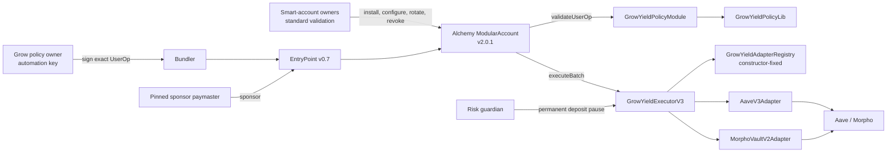
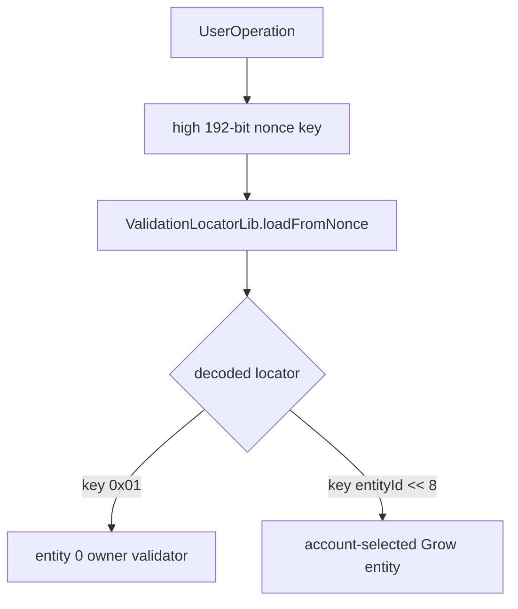
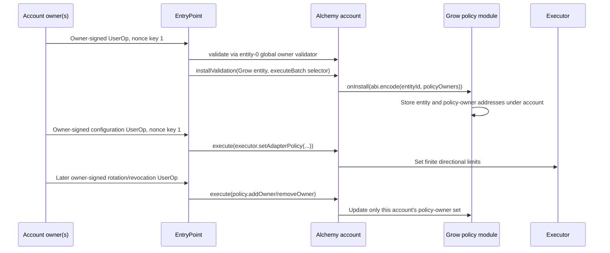

# GrowYield validation architecture

## Scope and pinned account

GrowYield is a selector-associated ERC-6900 UserOperation validator plus a tightly
bounded yield executor. This repository tests the integration against the actual
Alchemy `ModularAccount` source at tag `v2.0.1`, commit
`efab648bd91f79685571af7fa88171e3c142f2f6`, and EntryPoint v0.7.

The production account may use a multi-owner validation module for its normal owner
path. The local compatibility test uses a small SingleSigner harness for that owner
path; owner aggregation is independent of Grow's nonce routing and module payload.
If “MultiOwner Modular Account” means Alchemy's older v1 MSCA factory/plugin product
rather than a multi-owner validator installed on Modular Account v2, its encoder must
be verified separately—the two account generations do not share UserOperation
framing.

## System architecture



The layers are deliberately separate:

| Layer | Enforced property |
|---|---|
| Alchemy account | Selects the installed validation entity and applies selector scope |
| Policy module | Authenticates an account-scoped policy owner and constrains UserOp fields |
| Policy library | Accepts only one canonical approve/execute/revoke batch shape |
| Executor | Pins recipients, resolves amounts, checks output floors, budgets, and pauses |
| Registry | Fixes adapter addresses, directions, token pairs, and runtime code hashes |
| Adapters | Translate the uniform executor API into venue-specific calls and drift checks |

## Contract catalogue

### `GrowYieldPolicyModule`

This is the UserOperation-only validation module. Per smart account it stores:

- The nonzero validation `entityId` chosen during installation.
- Up to eight policy-owner addresses.

The entity is account-configurable because ERC-6900 entity IDs are unique within an
account, not globally reserved. Example entity `1` is suitable only after confirming
that the account has not already allocated it.

For each UserOperation the module requires:

- The account calls the module on its own UserOperation (`msg.sender == userOp.sender`).
- The entity passed by the account equals the entity stored for that account.
- No `initCode`.
- The constructor-pinned paymaster.
- Verification, call, pre-verification, paymaster, priority-fee, and max-fee fields at
  or below immutable ceilings.
- Canonical Grow calldata accepted by `GrowYieldPolicyLib`.
- A 65-byte ECDSA authorization over the exact `userOpHash`.
- A recovered signer present in the account's policy-owner set.

The module returns no ERC-4337 time range and does not read `block.timestamp` during
validation.

Policy-owner management functions are `addOwner` and `removeOwner`. They
key changes by `msg.sender`, so the smart account itself must call them through its
normal owner-authorized path. The Grow policy cannot call either function.

### `GrowYieldPolicyLib`

The library accepts exactly this `executeBatch` shape:

```text
approve(sourceToken[0], executor, uint256.max)
...
approve(sourceToken[n], executor, uint256.max)
executor.execute(Operation[])
approve(sourceToken[0], executor, 0)
...
approve(sourceToken[n], executor, 0)
```

Source tokens are the unique operation source tokens in first-appearance order. The
library rejects noncanonical ABI, native value, self-calls, extra bytes, more than
four operations, zero adapters/tokens, and any operation without an absolute output
floor. The executor independently re-derives each token from the adapter.

### `GrowYieldExecutorV3`

Every operation is signed as the following static tuple:

```solidity
struct Operation {
    IYieldAdapter adapter;
    OperationKind kind;       // DEPOSIT or REDEEM
    address sourceToken;
    uint256 amount;
    AmountMode amountMode;    // EXACT, FULL_BALANCE, PREVIOUS_OUTPUT
    uint256 minAmountOut;     // absolute signed floor
}
```

Amount modes are explicit:

| Mode | Meaning |
|---|---|
| `EXACT` | Use the nonzero signed `amount` |
| `FULL_BALANCE` | Use the caller's current source-token balance; `amount` must be zero |
| `PREVIOUS_OUTPUT` | Use only the immediately preceding operation's measured output; `amount` must be zero and tokens must match |

`PREVIOUS_OUTPUT` is the safe rebalance mode. It prevents a rebalance from sweeping
unrelated idle underlying already held by the account.

For every operation the executor:

1. Confirms registry direction, account policy, code hash, and deposit-pause state.
2. Re-derives source and output tokens and checks the signed source declaration.
3. Resolves the explicit amount mode and consumes the directional epoch budget.
4. Reads the adapter preview.
5. Transfers the exact source amount directly from the account to the adapter.
6. Invokes the adapter, which credits output directly to the account.
7. Rejects new residual balances or fee-on-transfer source behavior.
8. Measures actual account output.
9. Requires output to meet both the preview-relative floor and signed absolute floor.

The effective floor is:

```text
max(
  ceil(preview * (10_000 - maxLossBps) / 10_000),
  operation.minAmountOut
)
```

The preview-relative check limits unexpected venue slippage. The absolute floor
protects against a manipulated or compromised preview returning a misleading value.

### Adapter policies

Each account owns separate deposit and redeem source-volume limits for every fixed
adapter. `setAdapterPolicy` changes limits without clearing already-consumed volume.
Changing the epoch duration requires `resetAdapterPolicy`, which explicitly resets
usage and emits `AdapterPolicyUsageReset`.

`type(uint256).max` is rejected as `UnboundedPolicy`: it would make the quantitative
limit meaningless. Limits must be finite and chosen in the source token's native
units. Zero disables one direction; two zero limits revoke the adapter for that
account while retaining prior usage unless an explicit reset is requested.

### Risk guardian

The executor has one immutable `riskGuardian`. It can permanently pause new deposits
through a registered adapter. It cannot unpause, move funds, change limits, admit an
adapter, or block redemptions. This adds incident-response value without giving the
guardian a withdrawal or migration power. Recovery from a false pause requires a
new deployment and owner-approved migration.

### `GrowYieldAdapterRegistry`

The registry is constructor-only and has no owner or mutation function. It records:

- Each adapter in constructor order.
- Deposit and redeem permissions.
- Each adapter's deployment-time runtime code hash.

Construction verifies the adapter's pinned executor and nonidentical deployed asset
and position tokens. Enumeration through `adapterCount` and `adapterAt` supports
monitoring without adding mutation authority. Proxies are still unsuitable: a
proxy's runtime code hash can stay constant while its implementation changes.

### `AaveV3Adapter`

The Aave adapter pins one pool, data provider, asset, aToken, and executor. Deposits
re-check that the reserve still points to the pinned aToken. It uses `forceApprove`,
supplies the exact amount, clears venue allowance, and verifies exact consumption.

Redemptions withdraw the exact caller-attributed aToken amount. They do not use
Aave's `uint256.max` sentinel and therefore do not sweep aToken donations already at
the adapter into another user's redemption.

### `MorphoVaultV2Adapter`

The Morpho adapter accepts only a factory-authenticated VaultV2 wrapper with one
factory-authenticated Morpho VaultV1 child adapter, matching assets, fixed liquidity
routing, empty liquidity data, and abdicated adapter-add/remove selectors.

Deposits re-check child eligibility, liquidity routing, and all required round-trip
gates. Deposit and redeem verify ERC-4626 receiver deltas and exact source
consumption. Later governance, gates, liquidity, or losses can still impair exits.

## How Alchemy chooses Grow instead of the owner validator

Alchemy Modular Account v2.0.1 derives a validation locator from the high 192-bit
EntryPoint nonce key. For a normal entity validation:

```text
nonceKey = (uint192(entityId) << 8) | options
```

The low option bit means global validation. With an example Grow entity of `1`:

| Path | Entity | Options | Nonce key |
|---|---:|---:|---:|
| Standard global entity-zero owner op | `0` | `1` | `0x01` |
| Selector-associated Grow op | `1` | `0` | `0x0100` (`256`) |

Nonce key `1` does not contain or overwrite entity `1`. It decodes as entity `0`
plus the global option. Entity `1` lives in the next four bytes and produces key
`0x0100`. EntryPoint maintains an independent 64-bit sequence for every key.



Production code must query the complete nonce with:

```text
ownerNonce = EntryPoint.getNonce(account, 1)
growNonce  = EntryPoint.getNonce(account, uint192(growEntityId) << 8)
```

The module address is not prefixed to a v2.0.1 UserOperation signature. The nonce
already selected the validation storage entry. With no validation hooks, the complete
Grow signature is:

```text
0xFF || bytes65(growECDSASignature)
```

Alchemy strips the final sparse-segment marker and passes exactly 65 bytes to
`GrowYieldPolicyModule.validateUserOp`. The reference encoder is implemented in
[`grow-encoder.ts`](../script/ts/mav2-poc/grow-encoder.ts).

## Owner-authenticated onboarding and policy-owner rotation



Recommended install data is:

```text
abi.encode(
  growEntityId,
  address[] policyOwners
)
```

The account install call must use the same `growEntityId`. Preflight the account
loupe before choosing it. Alchemy rejects an already-occupied entity; Grow also fails
closed if the account passes a different entity during later validation. Grow stores
one entity per account and rejects a second installation; uninstall the old entity
before selecting a replacement so the account cannot retain stale dual registrations.

The account-owner path—not the Grow policy—must also set finite adapter limits. A
policy owner cannot authorize `installValidation`, owner management, policy
management, guardian actions, arbitrary `execute`, or an arbitrary `executeBatch`.

## Automated rebalance execution flow

```mermaid
sequenceDiagram
    participant B as Grow policy owner
    participant R as Bundler
    participant EP as EntryPoint v0.7
    participant A as Alchemy MA v2.0.1
    participant P as Grow policy
    participant X as Executor
    participant S as Source adapter
    participant D as Destination adapter

    B->>B: Quote redeem and destination deposit
    B->>B: Build REDEEM + PREVIOUS_OUTPUT DEPOSIT
    B->>B: Set absolute minAmountOut for both operations
    B->>EP: getNonce(account, entityId << 8)
    B->>B: Finalize gas, pinned paymaster, fees, calldata
    B->>B: Sign EIP-712 authorization(userOpHash)
    B->>R: Submit 0xFF || authorization
    R->>EP: handleOps
    EP->>A: validateUserOp
    A->>P: validateUserOp(entityId, op, hash), 65-byte segment
    P->>P: Check policy owner, sponsor, gas, fees, batch shape
    P-->>EP: success or signature failure
    EP->>A: executeUserOp then executeBatch
    A->>X: execute([redeem, deposit])
    X->>S: Redeem source position to account
    X->>X: Measure previous output
    X->>D: Deposit exactly previous output
    X-->>A: Measured outputs; idle underlying remains untouched
```

The policy owner should persist the `(account, entityId, nonce key, sequence)` it
submits, but EntryPoint remains the source of truth for the next nonce. It should
simulate the final signed UserOperation through the production bundler and stop
signing before key rotation. Because the module supplies no time range, an unsubmitted
authorization remains usable while its nonce is current and its owner is authorized.

## Revocation and incident response

Independent controls are available:

1. Remove a policy owner through the account-owner path.
2. Set one or both account adapter directions to zero.
3. Permanently pause new deposits deployment-wide through the risk guardian.
4. Uninstall the Grow validation entity through the owner path.
5. Stop sponsor approval at the pinned paymaster.

Keep redemptions enabled during venue incidents whenever the venue still permits an
exit. Neither local contracts nor the guardian can guarantee external liquidity,
solvency, or future gate access.

## Verification boundary

The suite executes install, policy configuration, entity-specific nonce selection,
final-segment signature parsing, sponsored validation, deposit, redemption,
reallocation, replay rejection, and policy-owner revocation against Alchemy's
pinned v2.0.1 `ModularAccount` source. It also includes unit, adversarial, invariant,
Halmos-oriented, and optional Base Aave fork tests.

Production still requires reviewed direct adapter bytecode, verified constructor
arguments, a non-token-charging sponsor, realistic per-token limits and output floors,
operational key rotation, and bundler simulation under the deployed chain's ERC-7562
rules.
